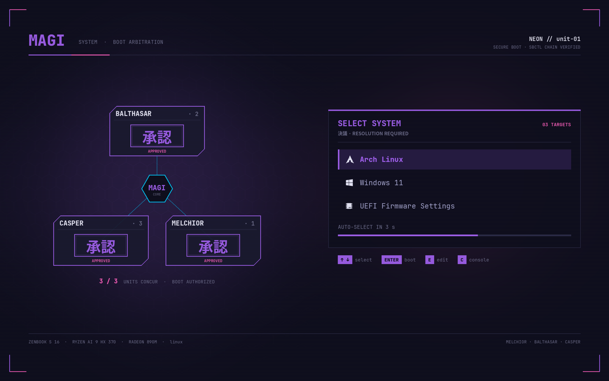

# dotfiles · unit-01 (laptop)

Hyprland rice for an ASUS Zenbook S 16 (Ryzen AI 9 HX 370 / Radeon 890M), "midnight neon" palette.
The desktop lives in `Tjabooo/dotfiles-desktop` ("ember"); this one is for media + development.

## Layout

| repo path | goes to |
|---|---|
| `alacritty/ dunst/ fastfetch/ hypr/ mpv/ neon/ nvim/ ohmyposh/ pacman/ satty/ systemd/ rofi/ waybar/ zed/` | `~/.config/<same>` |
| `vesktop/themes/` | `~/.config/vesktop/themes/` (Vesktop) and `~/.config/Vencord/themes/` (Discord + Vencord) |
| `mimeapps.list` | `~/.config/mimeapps.list` |
| `homedir/.zshrc .bashrc .bash_profile` | `~/` |
| `homedir/.local/bin/neon-*`, `homedir/.local/bin/codex`, `homedir/.local/bin/clipdeck`, `homedir/.local/bin/screen-awake` | `~/.local/bin/` |
| `homedir/.local/share/neon/` | `~/.local/share/neon/` (system-fixes.sh, GRUB theme builder, 10_neon source) |
| `system/etc/…`, `system/usr/local/bin/…` | the same paths under `/` (root-owned; copy with sudo) |

## How the session starts

`hypr/hyprland.lua` (Hyprland 0.55+ Lua config) runs `systemctl --user restart neon-session.target`
on start and stops it on shutdown. That target `BindsTo=graphical-session.target` and pulls in
waybar, dunst, hypridle, hyprpaper, cliphist, hyprpolkitagent and neon-power as normal user
units, so they restart when they crash and log to `journalctl --user -u <name>`.
(`hypr/autostart` is the old launcher script and is no longer used.)

## Laptop extras

- **neon-power**: on plug / unplug it reloads Hyprland; `hyprland.lua` reads `AC0/online`
  when it loads → 120 Hz + full blur/shadows on AC, 60 Hz + light blur on battery.
  Low-battery notifications at 15 % and 7 %.
- **Waybar wake eye**: click to keep screens awake (no automatic dim, lock, OLED blanking or idle suspend).
  Click again for normal idle. Uses `screen-awake.service`; survives bar restarts and resets at logout.
  Manual lock, suspend and lid handling keep working.
- **hypridle**: dim (restores *your* brightness) → lock → screen off → suspend on battery only.
- **neon-osd**: volume / brightness / mic keys with an on-screen bar (dunst).
- **neon-shot**: Print-key screenshots via hyprshot → satty; `SUPER+Print` re-edits the last one.
- **neon-update** (`update`): Arch news → `yay -Syu` → .pacnew → orphans → reboot hint.
- **neon-keys** (`SUPER+/`): the desktop's keybind overlay (eww, `neon/eww/`), built live from the
  `-- comments` on the binds in hyprland.lua; Esc / Enter / `SUPER+/` close it. `keys` prints it in the terminal.
- Power menu (`SUPER+Escape`) shows all six entries without scrolling and can do a one-shot reboot
  into Windows (GRUB or systemd-boot, whichever booted).
- **House dot** (waybar `custom/house`): home server health from Marquee's House tab via
  `marquee-house` (lives in the marquee repo, `agents/`); hidden away from home or when not installed.

## Clipboard history across the home network

**SUPER+V** opens `clipdeck` in the neon overlay. Its three columns show this
machine’s cliphist history, the other Arch machine’s history, and native Windows
clipboard history, newest first. Press an entry’s displayed key or click it to
copy it here; Escape closes the picker. Windows history starts collecting items
when enabled in Windows Settings → System → Clipboard. If it is empty, disabled,
or unavailable, the column shows the current Windows clipboard and says why.
Selecting an older Windows item leaves Windows’ current clipboard unchanged.

`homedir/.local/bin/clipdeck` launches the separately installed Archfleet helper
at `~/.local/share/archfleet/clipdeck.py`. Archfleet (with clipdeck and its Windows desktop
bridge) is its own repo, [Tjabooo/archfleet](https://github.com/Tjabooo/archfleet): update both
Arch machines with `git pull && ./install.sh` from a clone. The helper uses existing SSH aliases
and the same-user Windows named pipe, without another network listener or cloud sync.
The overlay stores only its visible previews temporarily in the private runtime
directory while open. Clipboard contents and credentials stay out of this repo.

## Discord / Vesktop theme

`vesktop/themes/neon.theme.css` adapts the desktop's Ember layout to this laptop's
midnight neon palette: navy panels, violet/pink accents, lavender text, JetBrainsMono
and 12px panel corners. It uses [midnight by refact0r](https://github.com/refact0r/midnight-discord)
as its base; the laptop currently runs Discord with Vencord.

```sh
mkdir -p ~/.config/vesktop/themes ~/.config/Vencord/themes
cp vesktop/themes/neon.theme.css ~/.config/vesktop/themes/
cp vesktop/themes/neon.theme.css ~/.config/Vencord/themes/
```

In Discord/Vesktop, select Dark appearance and enable **midnight neon** under
**Settings → Vencord → Themes → Local Themes**. Only the theme is versioned here;
keep account and plugin settings local. Hyprland already provides window opacity/blur.

## Codex over SSH

`homedir/.local/bin/codex` exposes the desktop app's bundled CLI from
`/usr/lib/chatgpt/resources/codex` to SSH login shells. Install the desktop app,
copy the launcher to `~/.local/bin/`, and sign in once through the app.
Verify with `ssh arch-laptop 'PATH="$HOME/.local/bin:$PATH"; codex --version'`.

The home network's Windows host uses the separate `home-server-codex` SSH alias;
its compatibility bridge is maintained in `home-network/codex-remote` on home-server.
SSH keys and account credentials stay outside this repository.

## Boot: GRUB + Secure Boot (sbctl, no shim)

The firmware trusts only the sbctl key (no Microsoft CA), so there's no shim/MOK like on the
desktop: GRUB itself is signed with the sbctl key.

- `system/usr/local/bin/grub-install-signed`: grub-install with every module built in (Secure
  Boot lockdown can't load modules from disk), sbctl sign, grub-mkconfig. Run again by
  `system/etc/pacman.d/hooks/90-grub-signed.hook` on every grub upgrade; sbctl's own hook re-signs
  kernels.
- Menu = **Arch Linux · Windows 11 · UEFI Firmware Settings**. `system/etc/grub.d/10_neon`
  replaces the stock `10_linux` (which always adds "Advanced options"); `NoExtract =
  etc/grub.d/10_linux` in pacman.conf keeps upgrades from bringing it back. It only knows the
  stock `linux` kernel: add an entry there if you install another one.
- Windows chainloads the **sbctl-signed** copy at `/EFI/WindowsChain/bootmgfw.efi`
  (Microsoft's own loader would be refused). os-prober is off.
- Theme "magi-neon": `homedir/.local/share/neon/grub-theme/build.py` (port of the desktop's ember
  "magi" theme, midnight neon, drawn for 2880x1800). Rebuild + install:
  `python3 build.py && sudo cp -r magi-neon /boot/grub/themes/ && sudo grub-mkconfig -o /boot/grub/grub.cfg`
- `grub-promote.service`: one-shot, moved GRUB to the front of the firmware boot order after its
  first successful boot (done; it disabled itself). systemd-boot stays installed as the fallback.



## Install on a fresh machine

```sh
for d in alacritty dunst fastfetch hypr mpv neon ohmyposh pacman rofi satty systemd waybar zed; do
  mkdir -p ~/.config/$d && cp -r $d/. ~/.config/$d/
done
cp mimeapps.list ~/.config/
cp -r homedir/. ~/
systemctl --user daemon-reload
# packages the config expects:
sudo pacman -S --needed hyprland hyprlock hypridle hyprpaper hyprshot hyprpolkitagent \
  xdg-desktop-portal-hyprland waybar dunst rofi satty cliphist wl-clipboard brightnessctl \
  playerctl pacman-contrib zoxide pkgfile alacritty kitty yazi mpv ttf-jetbrains-mono-nerd jq
yay -S eww   # keybind overlay (AUR)
```
